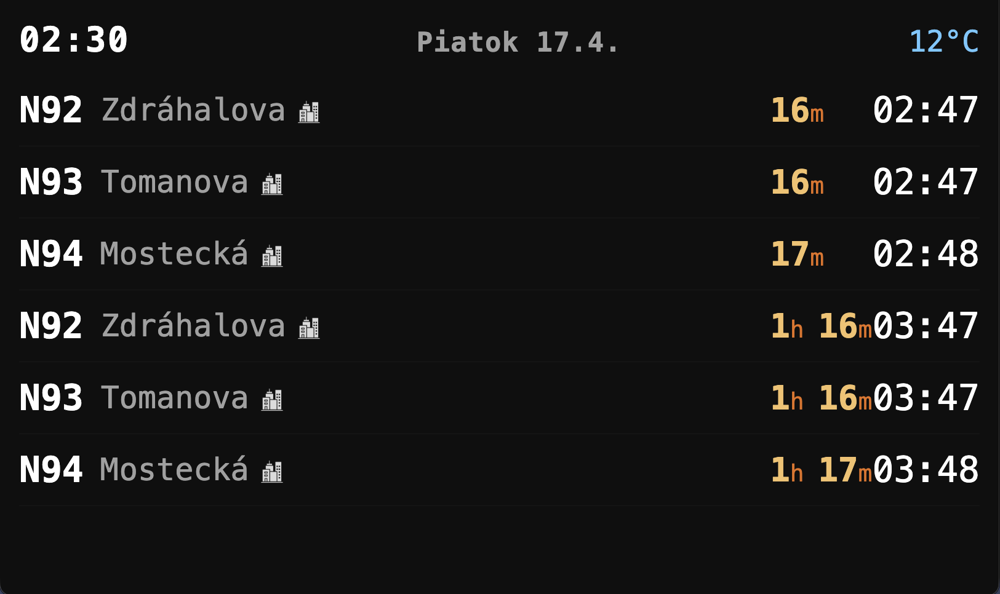

# Brno Tram Display



Real-time departure board for Brno trams — terminal and web. Uses free Czech open data, no API keys required.

**Data sources:**
- **Schedules**: [KORDIS GTFS](https://kordis-jmk.cz/gtfs/gtfs.zip) — re-fetched every 24h, CC BY 4.0
- **Live positions**: [KORDIS GTFS-Realtime](https://kordis-jmk.cz/gtfs/gtfsReal.dat) vehicle positions (CC BY 4.0), polled every 30s. The feed has no delay field, so delay is derived per trip by comparing each vehicle's last report with the scheduled time at its next stop.
- **Weather**: [Open-Meteo](https://open-meteo.com/) — temperature, sunrise/sunset for web theme switching

## Quick start

```bash
# Docker (recommended)
docker compose up --build

# Local
npm install && npm start
```

Web interface available at `http://localhost:3000` when running in `web` or `both` mode. With Docker it is published on host port `3001`.

## Display modes

| Mode | How to set | Result |
|------|------------|--------|
| Terminal only | `DISPLAY_MODE=default` (or unset) | ANSI terminal display, no web server |
| Web only | `DISPLAY_MODE=web` | HTTP server at http://localhost:3000 |
| Both | `DISPLAY_MODE=both` | Terminal + web server |

```bash
DISPLAY_MODE=web npm start
```

## Project structure

```
index.js                    # entry point, polling loop
src/
├── adapters/
│   ├── kordis.js           # public API: fetchDepartures, searchStops
│   ├── kordis-gtfs-cache.js    # GTFS zip download, parse, in-memory cache
│   ├── kordis-realtime.js      # GTFS-RT vehicle positions → per-trip delay
│   └── openmeteo.js            # weather fetch (temperature, sunrise/sunset)
├── config/
│   ├── constants.js        # URLs, timeouts, magic numbers
│   └── stops.js            # default stop list
├── display/
│   ├── terminal.js         # ANSI terminal rendering
│   ├── web.js              # HTTP server & routing
│   ├── web-data.js         # data assembly and deduplication for web
│   └── web-renderer.js     # HTML/CSS/JS renderer, HTMX polling
└── utils/
    ├── csv.js              # custom CSV parser (handles GTFS quoted fields)
    ├── string.js           # accent-insensitive search normalization
    └── time.js             # Prague timezone, GTFS overflow time handling
res/                        # static logo images served by web display
scripts/
├── rebuild.sh         # production redeploy script
└── setup-runner.sh         # GitHub Actions self-hosted runner setup
```

## Configure stops

Edit `src/config/stops.js` directly:

| Field | Required | Description |
|-------|----------|-------------|
| `stopId` | yes | GTFS `stop_id` from `stops.txt` |
| `name` | yes | Display label |
| `direction` | no | Headsign substring filter (accent/case-insensitive) |
| `lines` | no | Line number whitelist, e.g. `["3","7"]` |
| `minMinutes` | no | Hide departures sooner than N minutes away |
| `logo` | no | Filename from `res/` folder, shown in web display |

## Environment variables

| Variable | Default | Description |
|----------|---------|-------------|
| `DISPLAY_MODE` | `default` | `default` (terminal), `web`, or `both` |
| `PORT` | `3000` | Web server port |
| `POLL_INTERVAL_MS` | `30000` | Data refresh interval (ms) |
| `DEPARTURES_PER_STOP` | `10` | Max departures shown per stop |
| `DEPARTURES_WINDOW_MINUTES` | `90` | How far ahead to look for departures |
| `GTFS_REFRESH_INTERVAL_MS` | `86400000` | GTFS re-download interval (24h) |
| `STOPS` | (from config) | JSON array of stop objects, overrides `stops.js` |
| `DEBUG` | unset | Set to `1` for verbose per-trip logging |

Docker-only (read from a `.env` file next to `docker-compose.yml`, see `.env.example`):

| Variable | Default | Description |
|----------|---------|-------------|
| `BIND_IP` | `0.0.0.0` | Host address the board is published on |

## Preview mode (testing display states)

The web display accepts query params on `/` to force a visual state without waiting for real conditions — useful for checking day/night theming or weather icons after a CSS change.

| Param | Values | Effect |
|-------|--------|--------|
| `testMode` | `day`, `night`, `sunrise`, `sunset` | Forces the color theme instead of computing it from sunrise/sunset |
| `testWeather` | `clear`, `drizzle`, `rain`, `snow`, `storm` | Forces the weather alert icon |
| `testCycle` | seconds (e.g. `5`) | Auto-cycles through modes and/or weather states every N seconds, with sped-up (1.5s) transitions so changes are visible immediately |

Examples:
```
http://localhost:3000/?testMode=sunset
http://localhost:3000/?testWeather=storm
http://localhost:3000/?testMode=night&testWeather=snow
http://localhost:3000/?testCycle=5                          # cycles all modes + weather every 5s
http://localhost:3000/?testWeather=rain&testCycle=5         # weather pinned to rain, only modes cycle
```

## Deploy

The project ships with a self-hosted GitHub Actions runner that auto-deploys on push to `main`.

Manual redeploy:
```bash
./scripts/rebuild.sh -y            # rebuild and restart
./scripts/rebuild.sh --no-cache -y # force full image rebuild
```

The script stops the container, rebuilds the image, restarts, and cleans up dangling images.

### Binding to a LAN address

The port mapping in `docker-compose.yml` must always carry an explicit host IP. A bare `3001:3000` makes Docker listen on IPv6 as well, and Docker ignores host firewall rules, so on a network with a public IPv6 prefix the board can be reachable from the internet. The default `0.0.0.0` binds IPv4 only on every interface. Check with `ss -ltn | grep 3001`: there should be a `0.0.0.0:3001` line and no `[::]:3001`.

To restrict further, set `BIND_IP=<lan address>` in `.env`. The catch: if Docker starts at boot before that address is assigned, the container fails with `cannot assign requested address` and is **not** retried, even with `restart: unless-stopped`. To avoid that, give the server a static address and make Docker wait for the network. Edit the Docker unit (`docker.service`, or `snap.docker.dockerd.service` for the snap install; `systemctl list-units | grep -i docker` shows which) with `sudo systemctl edit <unit>` and add:

```ini
[Unit]
After=network-online.target
Wants=network-online.target
```

If the board is down after a reboot, `docker inspect brno-tram-display --format '{{.State.Error}}'` shows whether this was the cause; `docker compose up -d` brings it back.